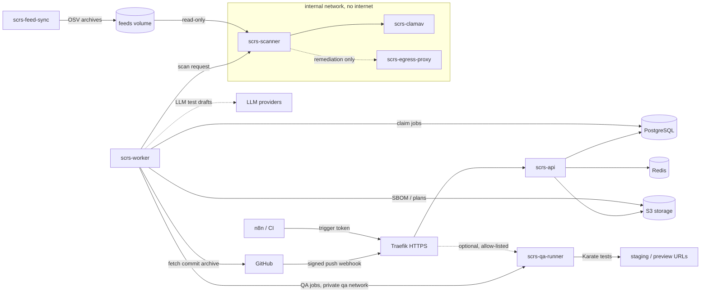

# SCRS: Software Supply Chain Risk Stack

SCRS is our in-house DevSecOps service for software supply-chain security. It
assesses every commit of our repositories and every pushed container image,
and documents each revision with two CycloneDX bills of materials:

- **SBOM (Software Bill of Materials):** what the software contains: every
  OS and language package, with versions and package URLs.
- **MBOM (Manufacturing Bill of Materials):** how the software is made: the
  build definitions and pinned inputs (CI workflows, Dockerfiles, build
  scripts, lockfiles) with SHA-256 digests, the produced commit or image
  digest, and the tools that verified it.

SCRS matches known vulnerabilities and malicious packages offline, scans file
content and image layers for malware and threat indicators, and keeps the
results in a single risk register with triage, waivers and an audit trail.
Automation such as n8n, CI pipelines and deploy tooling talks to it over one
authenticated REST API: inbound to trigger assessments, outbound through signed
webhooks.

SCRS started as a fork of [ajilach/clamav-rest](https://github.com/ajilach/clamav-rest),
a ClamAV scanner behind a REST API. That project is still the base: ClamAV is
the malware engine of the assessment pipeline, and the original REST scanner
remains in this repository as a hardened internal service. Everything else
(the API, the pipeline, the register, provider connections and the deployment)
was added on top. The full product specification is in
[Supply_Chain_Risk_Stack.md](Supply_Chain_Risk_Stack.md).

> **Status (2026-11-14):** repository (GitHub, GitLab) and container-image
> assessment with layer malware scanning, SBOM and MBOM, inbound automation
> triggers and signed outbound webhooks, relay and registry ingestion, Trivy
> and SARIF import, git-history mirrors, integrity alerts, YARA, KEV/EPSS, VEX
> export and scheduled maintenance are implemented and verified (see the
> [production-readiness audit](docs/PRODUCTION_READINESS_AUDIT.md)), as are
> licences, built-in SAST and reachability, and the P2 features: Dependency-Track
> export, live events, STIG and PDF reports, and outbound licence compatibility.
> CPE matching is deferred (see the [roadmap](#roadmap)).

## Table of contents

- [What SCRS does today](#what-scrs-does-today)
- [What changed from the base project](#what-changed-from-the-base-project)
- [Architecture](#architecture)
- [Deploying on Dokploy (Traefik)](#deploying-on-dokploy-traefik)
- [First run: tokens, connections, first assessment](#first-run-tokens-connections-first-assessment)
- [Verdicts and CI gating](#verdicts-and-ci-gating)
- [Integrations: n8n, Trivy, Dependency-Track](#integrations-n8n-trivy-dependency-track)
- [API overview](#api-overview)
- [Security model](#security-model)
- [Roadmap](#roadmap)
- [Development and QA](#development-and-qa)
- [Documentation index](#documentation-index)
- [Base project: internal ClamAV REST scanner](#base-project-internal-clamav-rest-scanner)
- [History and credits](#history-and-credits)
- [License](#license)

## What SCRS does today

| Capability | What you get |
| --- | --- |
| **Provider connections** | GitHub (App, fine-grained PAT or OAuth token), GitLab (groups and subgroups, gitlab.com or self-managed), Docker Hub, Google Artifact Registry, Harbor and any OCI registry (GHCR, Quay, registry:2, Zot, Nexus). Credentials are stored AES-256-GCM encrypted and are never returned by the API. Include/exclude scope globs, credential rotation, disable without losing history. |
| **Asset discovery** | Inventories the repositories and images each connection can see and flags which are in scope. Only discovered, in-scope repositories can be assessed. |
| **Assessments** | One assessment per revision: a git commit (branch, tag-free push or pull-request head) or a container image digest. SCRS resolves refs and tags itself. A durable PostgreSQL job queue runs the pipeline with leases, retries, per-asset ordering and idempotency keys. Each assessment records a component diff and marks findings `new` or `existing` against the previous scan of the same ref, or the PR's base branch. |
| **Container images** | Images from any connected registry, resolved to a platform digest and streamed to the scanner (size-capped). OS and language packages, CycloneDX SBOM and offline OSV matching, plus ClamAV, YARA and IOC inspection of every layer file, including files a later layer deleted. Registry push events (Harbor, Docker Hub, GAR, CNCF Distribution) trigger assessments pinned to the pushed digest. |
| **SBOM** | CycloneDX 1.6 Software Bill of Materials per assessment, generated by SCRS from its component model with licences, stored content-addressed in S3 and verified by hash on download. Export as CycloneDX JSON or XML, or SPDX 2.3 JSON, by assessment or by SBOM digest (`/assessments/{id}/sbom?format=`, `/sboms/{id}/download`). |
| **Licences** | Licence of every component: declared (lockfiles, manifests, Alpine and Debian package databases), detected from licence files, or from deps.dev metadata. Normalised to SPDX expressions, categorised (permissive to network copyleft, source-available, non-commercial), and checked against a licence policy per asset distribution model (`internal`, `saas`, `distributed`). Review and deny results are register entries with waivers; the gate is report-only until the policy is made enforcing. Inventory, CSV/Markdown report and third-party notices. A policy aid, not legal advice. |
| **Safe versions** | Each vulnerability entry names fixed versions, safe versions (above the installed one and affected by no advisory the local mirror holds for the package), the smallest safe upgrade and the latest safe version, from registry version lists. |
| **SAST** | gosec (Go), Bandit (Python), OpenGrep (JavaScript, TypeScript, Java, Kotlin, Swift and more) and Bearer (JavaScript/TypeScript, Java, PHP, Ruby) in a separate sandboxed image with no network. Entries carry CWE ids, location and data-flow steps (no code), gate only when new, and record inline suppressions; adding one for an open entry raises an integrity signal. Custom OpenGrep rules, disabled rules and excludes globally or per asset. |
| **Reachability** | Go vulnerability entries are marked reachable (with a call trace), imported only or not reachable by govulncheck; scores move accordingly and nothing is closed for being unreachable. Other ecosystems report unsupported. |
| **Compliance evidence** | OWASP Top 10 (2021 and 2025), CWE Top 25 and PCI DSS 6.3.1–6.3.3 evidence reports for an asset, owner or the portfolio, as JSON, CSV or Markdown, with data time, feed freshness, SBOM gaps and unmapped counts. Custom CWE-mapping packs. Evidence, not certification. |
| **MBOM** | CycloneDX 1.6 Manufacturing Bill of Materials per assessment (`/assessments/{id}/mbom`): the produced commit or image digest, the build definitions and pinned inputs observed in that revision with SHA-256 digests, verifying tools and stage results, linked to the SBOM. It records declared build inputs, not an observed CI run; pair it with SLSA provenance where you have it. |
| **Vulnerabilities** | Offline OSV-Scanner matching against a local OSV mirror refreshed every six hours (default ecosystems `npm,Go,Maven,PyPI,Pub,SwiftURL,RubyGems,Alpine,Debian`). Repository suppression files are ignored. CISA KEV and EPSS raise priority for known-exploited and likely-exploited advisories. |
| **Malicious packages** | OSV `MAL-` reports (OpenSSF malicious-packages data) matched during the same pass. |
| **Malware and YARA** | Every extracted file is streamed to ClamAV (`INSTREAM`). A starter YARA ruleset (miner pools, XMRig, base64-to-shell, secret exfiltration) is installed into ClamAV on each deploy; a canary proves it is loaded. Stale signatures reduce coverage and raise a posture finding. |
| **YARA rulesets (YARA-X)** | Team rules written in the Web UI and third-party packs (for example YARA Forge) run with YARA-X, including the `pe`, `elf`, `math`, `hash` and `dotnet` modules, on every repository file and image layer file. New rulesets hunt (record only); admins promote them to alert or block. See [docs/THREAT_INTELLIGENCE.md](docs/THREAT_INTELLIGENCE.md). |
| **Threat indicators (IOC)** | Indicator sources, each in hunt, alert or block mode with a minimum confidence: file SHA-256, SHA-1 and MD5, domains, IPv4, URLs, package URLs, file-path and file-content regexes, workflow step names, and PR-title, branch and commit-message patterns applied to incoming GitHub events (PRD Appendix E). |
| **Integrity** | Workflows that serialize all secrets, workflow files changed since the last revision, npm install hooks, fetch-and-execute build steps and hidden CI helper scripts. Provider events raise immediate alerts: force pushes, ref deletions, create-then-delete branch churn, mass deletions, default-branch, visibility and repository changes, new collaborators and organization members. |
| **External scanner import** | Trivy JSON (vulnerabilities, misconfigurations, secrets with values discarded) and SARIF 2.1.0 (Semgrep, CodeQL and similar) recorded as assessments, so their findings share the register, waivers and gate. |
| **Git history mirrors** | On-demand or scheduled git bundles of every branch and tag (GitHub and GitLab) in S3, fetched natively without a git binary, checksum-verified, pruned to the newest N, restorable with `git clone`. |
| **Risk register** | Findings deduplicated by fingerprint across assessments, with lifecycle `open → triaged → in_progress → fixed`. Time-boxed waivers (`accepted`), suppressions and false positives, with full event history. |
| **E2E QA testing (Karate)** | After each successful assessment, a repository's Karate suites (API, integration, headless-Chromium UI, mocks) run against its deployed staging or preview environment on a runner you host, with optional karate-gatling load runs and thresholds. SCRS records scenarios, OpenAPI coverage and report-only findings (failing scenarios, untested operations, breached thresholds, setup gaps), and can draft Karate features and unit tests with your own LLM key (OpenAI, Anthropic, Gemini, Azure OpenAI, Mistral, Groq, DeepSeek, xAI, OpenRouter, Together, Ollama or any OpenAI-compatible endpoint), for human approval. Commits that fail the security gate never reach the runner. See [docs/QA_TESTING.md](docs/QA_TESTING.md). |
| **Guided remediation** | npm `package-lock.json` (in-place) and Maven `pom.xml` (override) plans generated in an isolated sandbox. Advice only: SCRS never writes to repositories. OpenVEX export reflects register triage. |
| **Automation API** | Token-scoped REST API (`admin`, `read`, `write`, `trigger`, `ingest:relay`). Inbound: idempotent and batch triggers carrying caller context, provider and registry webhooks. Outbound: signed event webhooks. Plus long-poll, latest-by-commit lookup, last-known-good revisions, Swagger UI and an OpenAPI contract. See [docs/STACK.md](docs/STACK.md) for how Core, the scanner, SAST and the QA runner connect and [docs/API_REFERENCE.md](docs/API_REFERENCE.md) for every endpoint by module. Every operation lists the scopes that may call it in its `security` requirement (any one is enough; `admin` always passes), a scope guide opens the contract, and a test checks the contract against the router. |
| **Outbound webhooks** | Signed (`X-SCRS-Signature`, plus `X-SCRS-Auth` for header-auth receivers such as n8n) events delivered from a transactional outbox with retries, dead-letter and redelivery: `assessment.completed`, `assessment.failed`, `finding.created`, `finding.status_changed`, `finding.rescored`, `malicious_dependency.reported`, `integrity.alert`, `feed.stale`, `connection.degraded`, `maintenance.completed`, `qa.completed`, `qa.failed`, `dependency_track.upload_failed`, `system.degraded`, `system.recovered`, each with a published JSON Schema (`/schemas/events`). `summary`, `full` and AI-`agent` payload profiles; subscriptions can be scoped to connections. |
| **Operations** | Owners and asset attributes, Prometheus metrics, request IDs and access logs, a queryable audit log (`/audit`), hourly maintenance (retention, key expiry, optional default-branch rescans), scoped resets, rebuilds, sensor updates, a schedule and versions view, inbound-event log with replay, opt-in source snapshots for restore. |
| **Retention** | Per data class (raw events, delivery log, closed findings, superseded scan artifacts, SBOMs and snapshots, remediation plans, QA reports, compliance reports, expired indicators, audit log), previewable, audited, with environment defaults. Keeps forever unless set. Open register entries, current revisions and assets on legal hold are never purged; the audit log keeps at least 365 days. |

## What changed from the base project

| Area | Base project (clamav-rest) | This fork |
| --- | --- | --- |
| Purpose | Scan uploaded files for viruses | Assess whole repository revisions for supply-chain risk |
| Engines | ClamAV | ClamAV, OSV-Scanner (vulnerabilities and malicious packages), YARA-X, IOC matching (STIX/TAXII), workflow-integrity checks, Karate E2E QA |
| Results | Per-request HTTP response | Durable assessments, SBOMs, a deduplicated risk register and an audit log |
| Inputs | File uploads, host paths | GitHub and GitLab commits and registry images via connections, per-connection signed webhooks or the trigger API |
| Auth | None (open CORS) | Hashed, scoped, expiring and revocable API tokens; Redis rate limits; exact CORS origins |
| Storage | None | PostgreSQL (state), Redis (admission control), S3-compatible storage (SBOMs and plans) |
| Deployment | Single container | Dokploy Compose stack behind Traefik with isolated scanner networking, plus a separate Karate runner image |
| ClamAV REST service | Public, unauthenticated, host-path scanning | Internal only, bearer token required, loopback ports, host-path routes return `410` |

## Architecture



All services run from one image (`deploy/Dockerfile.scrs`, a non-root `scratch`
image) except ClamAV, which uses the official image, and the Karate runner, which
has its own image (`deploy/karate-runner/Dockerfile`).

| Service | Role | Network exposure |
| --- | --- | --- |
| `scrs-storage-init` | Runs migrations and storage bootstrap, then exits | None |
| `scrs-api` | REST API on container port 7000 | Traefik only (`/scrs/v1/*`) |
| `scrs-worker` | Claims jobs, fetches snapshots, publishes results | Outbound to GitHub, PostgreSQL, S3 |
| `scrs-scanner` | Unpacks archives and runs OSV-Scanner, ClamAV and IOC checks | Internal `scanning` network only |
| `scrs-clamav` | ClamAV daemon; updates its own signatures | Internal plus outbound to ClamAV mirrors |
| `scrs-yara-rules` | One-shot: installs the embedded YARA ruleset into ClamAV's volume and reloads clamd | Internal |
| `scrs-feed-sync` | Downloads and validates OSV archives, CISA KEV and EPSS every 6 h | Outbound to the OSV bucket, cisa.gov and the EPSS host |
| `scrs-egress-proxy` | Allow-listed proxy for remediation (npm registry, deps.dev) | Internal |
| `scrs-qa-runner` | Karate runner: runs repository test suites against staging URLs (API, UI, load) | Internal `qa` network to SCRS; Traefik at `SCRS_QA_DOMAIN` behind an IP allowlist and the runner token, for operators running standalone QA and performance jobs (no supply-chain data); outbound to systems under test |

PostgreSQL, Redis and S3 are external services you provide. The pipeline itself
is described in [docs/ASSESSMENT_PIPELINE.md](docs/ASSESSMENT_PIPELINE.md).

## Deploying on Dokploy (Traefik)

The full contract is in [docs/DOKPLOY.md](docs/DOKPLOY.md). In short:

1. Build and push both images, then record the concrete tags:

   ```bash
   make image-reference
   make release PLATFORMS=linux/amd64,linux/arm64
   make release-qa-runner SCRS_QA_RUNNER_IMAGE=registry/namespace/scrs-qa-runner:scrs_YYYY_MM_DD_v{shortSHA256}
   ```

2. In Dokploy, create a Compose service from
   [`deploy/compose.dokploy.yaml`](deploy/compose.dokploy.yaml) and set every
   variable from [`.env.example`](.env.example). Generate secrets once:

   ```bash
   openssl rand -base64 32   # SCRS_MASTER_KEY: back it up outside the VPS
   openssl rand -hex 32      # SCRS_BOOTSTRAP_API_TOKEN
   openssl rand -hex 32      # SCRS_SCANNER_API_TOKEN (must differ)
   openssl rand -hex 32      # SCRS_QA_RUNNER_TOKEN (Karate runner)
   ```

3. Set `SCRS_DOMAIN`, `SCRS_QA_DOMAIN`, `SCRS_ROUTER_NAME`, `SCRS_TRAEFIK_NETWORK`, the entrypoints
   and `SCRS_CERT_RESOLVER` to match your Traefik. The Compose labels do the
   routing, so do not also add a domain in Dokploy's Domains UI.
4. Deploy. The first start can take several minutes while the OSV feeds
   download (npm alone is about 220 MiB). The worker starts once the scanner
   reports healthy.
5. Set `SCRS_PUBLIC_BASE_URL` and run `make deployment-acceptance`.

Without a published host port the API is reachable only through Traefik. For
diagnostics on the VPS itself, add
[`deploy/compose.nodeport.yaml`](deploy/compose.nodeport.yaml) to bind
`127.0.0.1:${SCRS_HTTP_NODE_PORT:-7000}`.

Losing `SCRS_MASTER_KEY` makes every stored provider credential unreadable.
A database backup cannot recover it.

## First run: tokens, connections, first assessment

Examples use `BASE=https://your-domain/scrs/v1` and the bootstrap admin token.
Swagger UI at `$BASE/docs` documents every request and response.

```bash
# 1. Create narrower tokens. The secret is returned once.
curl -sX POST "$BASE/tokens" -H "Authorization: Bearer $ADMIN" -H 'Content-Type: application/json' \
  -d '{"name":"n8n-trigger","scopes":["trigger"]}'
curl -sX POST "$BASE/tokens" -H "Authorization: Bearer $ADMIN" -H 'Content-Type: application/json' \
  -d '{"name":"dashboards","scopes":["read"]}'

# 2. Connect a GitHub organization, then test it and discover repositories.
curl -sX POST "$BASE/connections" -H "Authorization: Bearer $ADMIN" -H 'Content-Type: application/json' -d '{
  "provider":"github","name":"github-main",
  "config":{"organization":"YourOrg","auth_type":"fine_grained_pat"},
  "scope":{"include":["YourOrg/*"]},
  "credential":{"token":"github_pat_..."}}'
curl -sX POST "$BASE/connections/$CONNECTION_ID:test" -H "Authorization: Bearer $ADMIN"
curl -sX POST "$BASE/connections/$CONNECTION_ID:discover" -H "Authorization: Bearer $ADMIN"

# 3. Trigger an assessment (202 Accepted plus a Location header).
curl -si -X POST "$BASE/assessments" -H "Authorization: Bearer $TRIGGER" \
  -H 'Content-Type: application/json' -H 'Idempotency-Key: demo-1' \
  -d '{"target":{"type":"git","repository":"YourOrg/api","ref":"main"}}'

# 4. Read the results.
curl -s "$BASE/assessments/$ID" -H "Authorization: Bearer $TRIGGER"                  # status, verdict, counts
curl -s "$BASE/assessments/$ID/findings" -H "Authorization: Bearer $TRIGGER"
curl -s "$BASE/assessments/$ID/sbom" -H "Authorization: Bearer $TRIGGER" -o sbom.cdx.json
curl -s "$BASE/assessments/$ID/report?format=md" -H "Authorization: Bearer $TRIGGER"  # PR-comment sized
```

GitHub App connections and Docker Hub/GAR examples are in
[docs/PROVIDERS.md](docs/PROVIDERS.md).

## Verdicts and CI gating

Each assessment ends with a verdict. They rank `fail` > `incomplete` > `warn` > `pass`:

| Verdict | Meaning |
| --- | --- |
| `fail` | Malware, a malicious dependency or an IOC match (new or existing); a **new** critical vulnerability; a **new** high or critical integrity entry. Reported even when coverage was partial. |
| `incomplete` | No blocking finding, but at least one stage was skipped, partial or hit a limit. **Never treat this as `pass`.** |
| `warn` | A new high vulnerability, an existing critical one, a new medium or existing serious integrity entry, or waived malicious content (which can never drop below `warn`). |
| `pass` | Every stage completed and nothing gates. |

"New" means absent from the previous successful scan of the same ref (or of
the base branch for a pull request). Unexpired waivers (`accepted`),
suppressions and false positives do not gate, and are counted under
`counts.waived`. Absence from a later scan of the same branch head closes a
finding as `fixed` when the stages that produce it completed; change records
(workflow changes, provider events) stay open until reviewed.

A repository can reach `pass` once ClamAV signatures are fresh, the YARA
ruleset is loaded and an indicator bundle is imported (`PUT /feeds/indicators`).
**Block deploys on `verdict == "fail"`** and show `incomplete` as "no known
blocker, partial coverage".

## Integrations: n8n, Trivy, Dependency-Track

SCRS is designed to sit next to the tools we already run, not to replace them
on day one (PRD section 15.1).

### n8n

| Flow | Status |
| --- | --- |
| **Inbound trigger (automation webhook):** an n8n HTTP Request node posts the event to `POST /scrs/v1/assessments` with a `trigger` token restricted to n8n's IP: `target` names a discovered, in-scope asset, and `trigger.context` carries correlation data (ticket, change request, execution id) that comes back in `assessment.completed`. Use the source event id as `Idempotency-Key` so retries never double-scan. | Available |
| **Polling for results:** the response carries `Location` and `Retry-After`. Poll `GET /assessments/{id}` until `status` is `succeeded` or `failed`, then branch on `verdict` (Slack/Telegram message, ticket, or a GitHub commit status written with n8n's own credential). | Available |
| **Direct provider and registry webhooks** (no n8n in the path): `POST /scrs/v1/connections/{id}:webhook` gives each GitHub, GitLab, Harbor, Docker Hub, GAR or OCI connection its own secret and receiver URL (`/scrs/v1/ingest/<provider>/<connection>`). Outbound subscriptions can be scoped to connections. See [docs/PROVIDERS.md](docs/PROVIDERS.md#inbound-webhooks-per-connection). | Available |
| **Relay mode:** n8n forwards GitHub's or GitLab's unchanged body to the connection's receiver (`/scrs/v1/ingest/github/<connection>` or `/ingest/gitlab/<connection>`) with an `ingest:relay` token (`SCRS_RELAY_ENABLED=true`). A forwarded provider signature is verified against the connection's webhook secret. | Available |
| **Registry push events:** Harbor and OCI registries call `/ingest/registry/<provider>/<connection>` with the connection's secret as a bearer header. Docker Hub and GAR Pub/Sub, which cannot send headers, put it in the URL (`?token=`) or go through the registry relay workflow. | Available |
| **Outbound webhooks:** signed `assessment.completed`, `finding.created`, `integrity.alert` and more, with retries, dead-letter, redelivery and an AI-triage `agent` profile. | Available |
| **Batch trigger and nightly reconcile** (`/assessments:batch`, `/maintenance/rescan`) | Available |
| **Reference workflows** ([docs/integrations](docs/integrations/N8N.md)): GitHub relay, GitLab relay, registry relay, completion to commit status (Header Auth, no Code node), nightly reconcile; import-tested on n8n 1.97.1 | Available |

SCRS never writes back to GitHub. Commit statuses and PR comments come from n8n.

**Inbound and outbound together.** A typical n8n loop:

1. n8n receives an external event (release request, ticket, schedule) and calls
   SCRS inbound:

   ```bash
   curl -X POST "$BASE/assessments" -H "Authorization: Bearer $N8N_TRIGGER_TOKEN" \
     -H "Idempotency-Key: exec-4711" -H 'Content-Type: application/json' \
     -d '{"target":{"type":"git","repository":"acme/api","ref":"main"},
          "trigger":{"origin":"n8n","event":"release.requested","delivery_id":"exec-4711",
                     "actor":"release-bot","context":{"ticket":"CHG-1042","environment":"prod"}}}'
   ```

2. SCRS answers `202` with the assessment id. The token's scope, IP allow-list
   and rate limit are enforced, and only discovered, in-scope assets on enabled
   connections are accepted (`404` otherwise).
3. When the scan finishes, SCRS calls n8n outbound with `assessment.completed`
   (signed, with `X-SCRS-Auth`). `data.assessment.trigger.context` carries
   `CHG-1042` back, so the workflow updates the right ticket.

Context is correlation data only: at most 20 keys matching
`^[a-z0-9][a-z0-9._-]{0,62}$`, values up to 256 printable characters, never used
to choose what is scanned. Provider events take the dedicated per-connection
inbound endpoints (`/ingest/<provider>/<connection>`, `/ingest/registry/<provider>/<connection>`),
which verify that connection's signature or token.

### Trivy

Run Trivy in CI and post its JSON report to `POST /scrs/v1/assessments:import`
(`"format":"trivy"`, with the scanned commit or image digest as
`target.commit`). Its vulnerabilities, misconfigurations and secrets join the
same register, triage and waivers; secret values are discarded before storage.
SARIF from Semgrep, CodeQL or other SAST tools imports the same way
(`"format":"sarif"`). SCRS now covers image layers itself (packages, ClamAV,
YARA, IOCs), so Trivy remains useful mainly for misconfiguration and secret
rules.

### OWASP Dependency-Track

Keep Dependency-Track for portfolio-level component tracking. Every SCRS
assessment produces a CycloneDX SBOM with licences (`GET /assessments/{id}/sbom`,
also as XML or SPDX 2.3) and an MBOM (`GET /assessments/{id}/mbom`).

SCRS can push every scan's SBOM to Dependency-Track itself:

1. In Dependency-Track, create an API key for a team with `BOM_UPLOAD` and
   `PROJECT_CREATION_UPLOAD`.
2. Store it with `PUT /integrations/dependency-track` (admin, `If-Match`), with
   `{"enabled":true,"url":"https://dtrack.example.com","api_key":"..."}`. The key
   is sealed with the master key and never returned. An internal server on
   http must be listed in `SCRS_DTRACK_PRIVATE_HOSTS`.
3. Check it with `POST /integrations/dependency-track:test`. It reads the key's team permissions and reports `missing_permissions`; add `VIEW_PORTFOLIO` too, so SCRS can confirm each import.

How pushes work:
- Each completed scan with an SBOM is queued in the same database transaction.
- The worker uploads it with `PUT /api/v1/bom`. The project is the asset locator
  and the version is the ref; projects are created automatically, optionally
  under `parent_uuid`.
- Transient failures retry with backoff for about two days. Rejected keys or
  permissions fail at once and can be retried after a fix
  (`POST /integrations/dependency-track/uploads/{id}/retry`).
- `GET /integrations/dependency-track/uploads` lists uploads. `uploaded` means
  Dependency-Track accepted the BOM. The worker then checks its processing about every
  30 seconds for up to ten minutes: `processing` becomes `processed`, `unconfirmed`
  (the key cannot read projects, or time ran out) or `failed` (finished without importing).
- A rejected upload, or an import that failed, emits `dependency_track.upload_failed`
  and shows as `dependency_track` in `GET /system/status`.
- An unreachable Dependency-Track never affects an assessment.

### Live events for a frontend

`GET /scrs/v1/events` (scope `read`) is a server-sent-event stream of notices
for committed events (`assessment.completed`, `finding.created` and the other
webhook event types; filter with `?types=`).

- Each notice carries the event id, type, time and the ids to fetch. It never
  carries evidence or secrets.
- The stream sends a heartbeat every 20 seconds and ends after 10 minutes with
  `reconnect`, so revoked tokens stop receiving.
- Streams are fire-and-forget: reload state on connect and on `resync`. Use
  webhooks where delivery must be guaranteed.
- Browsers should read the stream with `fetch` so the token goes in the
  `Authorization` header, never in the URL.

## API overview

All routes live under `/scrs/v1`. An `admin` token satisfies every scope.
`trigger` tokens see only the assessments they created.

**Backoffice integration.** Swagger UI (`/scrs/v1/docs`) documents all 177
operations by tag, with request and response schemas, scopes and error codes.
Generate a typed client from `/scrs/v1/docs/openapi.yaml` (for example
`npx openapi-typescript https://scrs.example.com/scrs/v1/docs/openapi.yaml -o scrs.d.ts`).
Call SCRS from the backoffice backend with a server-side token, not from the
browser: tokens are long-lived bearer secrets. If the browser must call SCRS
directly, list the exact backoffice origin in `SCRS_CORS_ORIGINS`, use a
`read` token, and restrict it with `ip_allow_list`. Lists paginate with
`next_cursor`; mutable resources use `ETag`/`If-Match`; errors are
`{"error": "..."}`. `api/contract_test.go` and `internal/httpapi/contract_test.go`
fail the build if a route is added without documentation.

| Route | Scope | Purpose |
| --- | --- | --- |
| `GET /system/healthz`, `GET /system/readyz` | Public | Liveness; readiness of PostgreSQL, Redis and S3 |
| `GET /system/status` | read, write | Per-component state for a frontend: API, PostgreSQL, Redis, S3, worker, scanner, feeds, SAST, QA runner (cached 10 s) |
| `GET /docs`, `GET /docs/openapi.yaml` | Public (configurable) | Swagger UI and contract |
| `/tokens`, `DELETE /tokens/{id}` | admin | Create, list and revoke API tokens |
| `/connections`, `/connections/{id}`, `:test`, `:discover`, `:rotate-credential` | admin | Provider accounts, scope and credentials |
| `POST /connections/{id}:webhook` | admin | Set or rotate a connection's inbound webhook secret (and GitHub hook URL) |
| `GET /assets` | read | Discovered assets and scope flags |
| `GET/POST /assets/{id}/mirrors`, `GET /assets/{id}/mirrors/{mirror}/bundle` | read, write / admin | Git history mirrors and bundle download |
| `POST /assessments:import` | write, trigger | Trivy JSON or SARIF import |
| `POST /assessments` | write, trigger | Queue an assessment |
| `POST /assessments:batch` | write, trigger | Up to 100 targets with per-item results |
| `GET /assessments`, `/assessments/latest`, `/assessments/{id}` and `/findings`, `/components`, `/files`, `/sbom`, `/mbom`, `/report`, `/context`, `/vex`, `/remediations`, `/remediation` | read, write, trigger | Results, SBOM and MBOM, context documents and OpenVEX |
| `GET /assessments/{id}/snapshot` | admin | Stored source archive |
| `GET/PATCH /assets/{id}`, `GET /assets/{id}/last-known-good`, `GET/POST /owners`, `PATCH /owners/{id}` | read / write | Ownership and asset attributes |
| `/webhooks`, `/webhooks/{id}`, `:test`, `:rotate-secret`, `/deliveries`, `:redeliver` | admin | Outbound webhook subscriptions (optionally scoped to connections) and delivery log |
| `POST /ingest/github/{connection}`, `POST /ingest/gitlab/{connection}` | Connection webhook secret or `ingest:relay` | Direct or relayed GitHub and GitLab events for one connection |
| `POST /ingest/registry/{provider}/{connection}` | Connection webhook secret | Registry push events for one connection |
| `POST /ingest/github`, `POST /ingest/gitlab`, `POST /ingest/registry/{provider}` | Legacy shared secret or `ingest:relay` | Shared receivers kept for existing hooks |
| `/maintenance/run`, `/rescan`, `/redeliver-dead`, `/reset`, `/rebuild`, `/update-sensors`, `/schedule`, `/versions`, `/events/inbound`, `:replay` | admin | Maintenance and inbound-event log |
| `GET /system/metrics` | read | Prometheus metrics |
| `GET /system/github-webhooks`, `POST /system/github-webhooks:check` | read, admin | GitHub webhook delivery check: redelivers missed events, reports hook misconfiguration |
| `DELETE /assessments/{id}` | write (or owning trigger) | Cancel |
| `GET /register`, `GET /register/{id}/events` | read, write | Risk register and finding history |
| `PATCH /register/{id}` | write; admin to accept, suppress or mark false positive | Triage |
| `POST /assets/{id}/remediations`, `GET /remediation/capabilities` | write / read | Guided remediation plans |
| `GET`/`PUT /feeds/indicators` | admin | IOC bundle (the `bundle` source) |
| `/intel/indicator-sources` (list, create, get, patch, delete, `/indicators` get and put, `:import-stix`, `:hunt`) | read, write (hunt), admin (alert, block) | Indicator sources |
| `/intel/indicator-sources/{id}/taxii` (get, patch), `:poll`, `:test` | read; admin | TAXII 2.1 feeds |
| `/intel/yara-rulesets` (list, create, `:validate`, get, patch, delete, `:hunt`) | read, write (hunt), admin (alert, block) | YARA rulesets |
| `/settings/retention`, `:preview`, `:purge` | admin | Retention by data class |
| `GET /assessments/{id}/sbom?format=`, `GET /sboms/{id}/download` | read, write | CycloneDX JSON or XML, SPDX 2.3 JSON |
| `GET /policies/license`, `PUT /policies/license`, `POST /policies/license:evaluate`, `GET /policies/gate` | read; PUT admin | Licence policy, dry-run evaluation, default gate rules |
| `GET`/`PUT /licenses/categories`, `/licenses/categories/history` | read; PUT admin | Licence categories and versioned overrides |
| `GET /assets/{id}/licenses`, `/licenses/notices`, `GET /reports/licenses` | read, write | Licence inventory, third-party notices, licence report (JSON, CSV, Markdown) |
| `GET`/`POST /reports/frameworks`, `GET`/`DELETE /frameworks/{id}` | read; upload and delete admin | Framework packs |
| `POST /reports`, `GET /reports`, `/reports/{id}`, `/reports/{id}/download` | write to create; read | Compliance evidence reports |
| `GET /schemas/license-policy`, `/schemas/framework-pack` | read, write, trigger | Policy and pack JSON Schemas |
| `GET /sast/analyzers`, `GET /reachability/capabilities` | read, write | Bundled analyzers with versions and licences; reachability support |
| `GET`/`PUT /sast/settings`, `GET`/`PUT /assets/{id}/sast` | read; PUT admin (global) or write (asset) | Disabled rules, excludes, SAST and reachability per asset |
| `GET`/`POST /sast/rulesets`, `GET`/`DELETE /sast/rulesets/{id}` | read; POST write; DELETE admin | Custom OpenGrep rulesets, compiled before they are stored |
| `GET /audit` | admin | Audit log query |
| `GET /schemas/events`, `GET /schemas/events/{type}/{version}` | read | Outbound event JSON Schemas |
| `POST /intel/indicator-sources/{id}:import-csv` | write (hunt), admin (alert, block) | CSV indicator import |
| `/intel/vulnerability-sources`, `/{key}`, `:sync`; `GET /intel/vulnerabilities/{id}` | read / admin | Advisory sources, NVD and CVE Program records |
| `/intel/vex-documents`, `/intel/vex-documents/{id}`, `GET /intel/vex-statements` | read, write / admin (delete) | Vendor statements (VEX, CSAF) |
| `POST /webhooks/github` | Legacy GitHub HMAC | Signed push events (shared secret) |
| `GET/PUT/DELETE /assets/{id}/qa/profile` | read / admin | E2E QA profile: target URL, suites, secrets, load profile, LLM provider |
| `GET/POST /assets/{id}/qa/runs`, `GET /assets/{id}/qa/coverage`, `GET /assessments/{id}/qa` | read / write, trigger | QA runs and API-coverage history |
| `/qa/runs/{id}`, `/scenarios`, `/coverage`, `/report`, `:cancel`; `GET /qa/runner` | read / write, trigger | Run results, report archive, runner status |
| `/assets/{id}/qa/generations`, `/assets/{id}/qa/suites`, `/qa/generations/{id}`, `/files`, `/qa/suites/{id}`, `:approve`, `:reject` | read / write / admin (approve) | LLM-drafted Karate features and unit tests |
| `/llm/presets`, `/llm/providers`, `/llm/providers/{id}`, `:test` | read / admin | LLM providers for test generation |

## Security model

- **Tokens:** only SHA-256 hashes are stored. Tokens are scoped, can expire,
  can be restricted to IP ranges and are revocable. Revocation is checked in
  PostgreSQL on every request. Redis limits each token to 120 requests per
  minute and fails closed.
- **Credentials:** provider credentials, per-connection webhook secrets, TAXII
  credentials, LLM provider keys and QA profile variables are AES-256-GCM
  encrypted under `SCRS_MASTER_KEY`, each bound to its owner. None is ever
  returned by the API. Scanner subprocesses inherit no credentials.
- **Untrusted code:** archives are unpacked with traversal, link, special-file
  and size limits. The scanner never builds or executes repository content, and
  its network has no internet access. Remediation egress is allow-listed to
  public npm and deps.dev addresses. The only place repository code runs is the
  Karate runner (QA test suites). It holds no SCRS secrets, runs tests as a
  separate user with dropped capabilities, and never receives commits that
  failed the security gate. LLM-generated tests run only after admin approval.
- **Data safety:** there is no hard-delete API. Deleting a connection disables
  it and keeps its history. Retention deletes only what an admin's policy (or
  an environment default) names, class by class. It never touches open
  register entries, the current revision of a tracked ref, or assets on legal
  hold, and it keeps at least 365 days of audit log.
- **Edge:** Traefik terminates TLS. Forwarded client IPs are trusted only from
  `SCRS_TRUSTED_PROXY_CIDRS`. CORS accepts exact origins only.

## Roadmap

Milestones follow PRD section 15.2.

| Milestone | Status |
| --- | --- |
| M0 Foundations and spikes | Done: ADR-001 to ADR-024 in [docs/ADR.md](docs/ADR.md); spike outcomes and evidence in [docs/SPIKES.md](docs/SPIKES.md). Open: throughput measurements (S1, S4), the mobile sample-repo table (S3), NVD volumes (S9), and S10–S12 (part of M9) |
| M1 Platform core | Done: tokens, audit log with `GET /audit` (OBS-002), owners and asset attributes with `legal_hold`, metrics, request IDs, access logs |
| M2 Repository scanning | Done: trigger, batch, latest, long-poll, direct and relay GitHub ingestion, PR assessments, diffs and new-versus-existing gating, integrity events |
| M3 Malware and malicious dependencies | Done: ClamAV, YARA via ClamAV with canary, `MAL-` matching, campaign IOC types, KEV and EPSS |
| M4 Threat-intelligence feeds | Done: indicator bundles and sources with modes and confidence, CSV import, IPv6 indicators, YARA-X rulesets, STIX 2.1 upload, TAXII 2.1 polling, KEV/EPSS, Trivy and SARIF import, NVD and CVE Program records, OpenVEX/CycloneDX VEX/CSAF import, vulnerability-source registry with licences and health |
| M5 Retention, maintenance, outbound | Done: retention classes with legal hold, reset, rebuild, sensor update, schedule and versions actions, signed outbound webhooks with profiles, header auth, connection scope and published event schemas, `finding.rescored` and `malicious_dependency.reported`, per-connection inbound webhooks, event log and replay, n8n workflows, snapshots, git mirrors. Server-sent events (OUT-004) were added in P2 |
| M6 Images and registries | Done: Docker Hub, GAR, Harbor and OCI images by digest with layer scanning, registry push events, GitLab repositories and webhooks; Trivy parity recorded on Alpine, Debian 12 and Debian 13 images ([TRIVY_PARITY.md](docs/TRIVY_PARITY.md)) |
| M7 Remediation and hardening | Done: npm and Maven plans, OpenVEX export, load and crash-recovery test |
| E2E QA (Karate) | Done: runner service and image (in the Dokploy stack or on a separate VM), QA profiles, automatic runs after assessments, OpenAPI coverage, report-only QA findings, load runs, LLM-drafted Karate features and unit tests with approval. Open: acceptance with real LLM keys and on the VPS |
| M8 Licences, SPDX, compliance reports | Done: licence detection, normalisation, categories, policy by distribution, entries and waivers, inventory, report and notices (LIC-001 to LIC-009); SCRS-generated CycloneDX and SPDX 2.3 export (SBM-010, SBM-011); OWASP 2021/2025, CWE Top 25 and PCI DSS evidence reports with custom packs (CMP-001 to CMP-003, CMP-005, CMP-006); safe versions (VUL-008) ([LICENSES_AND_COMPLIANCE.md](docs/LICENSES_AND_COMPLIANCE.md)). STIG (CMP-004, ASD STIG by XCCDF import), PDF reports and outbound licence compatibility (LIC-005) were added in P2. Open: counsel review of corporate-default and the outbound rules (Q24) |
| M9 SAST and reachability | Done: analyzer framework and sandbox image with gosec, Bandit, OpenGrep and Bearer, normalised entries with data-flow steps, diff-aware gate, inline suppressions and suppression-added signal, rules and excludes, custom rulesets (SAST-001 to SAST-011); Go reachability by govulncheck with traces and scoring (REA-001 to REA-004, REA-006, REA-007); spikes S10 to S12 ([SAST.md](docs/SAST.md)). Open: reachability beyond Go (REA-005, REA-012, P2), Dart coverage, deduplication with imported SARIF of the same tool (SAST-012) |
| P2 items | Done 2026-11-15: Dependency-Track SBOM export, live events (OUT-004), ASD STIG import and reports (CMP-004), PDF reports, outbound licence compatibility (LIC-005). Deferred: CPE matching (VUL-007), pending spike S14, because SCRS has no inventory of software without a package URL |
| Release acceptance | Outstanding: live Dokploy deployment and TLS checks, real GitHub/GitLab/registry accounts, hosted backup and restore drills, signed release manifests, review of the ClamAV image's open CVEs |

## Development and QA

Requires Go (see `go.mod`), Docker and Python 3.

```bash
make build                 # bin/scrs
make test lint             # race tests, gofmt, go vet
make qa                    # test + lint + contract checks + deployment-config tests
make database-test         # disposable PostgreSQL/Redis/MinIO integration
make scanner-test          # real OSV-Scanner against adversarial fixtures
make malware-test          # private ClamAV: clean file and EICAR
make storage-integration   # production image against disposable stores
make qa-runner-test        # Karate runner against the pinned Karate 2.1.4 jar (Java 21)
make qa-runner-image-test  # runner image: API, Chromium UI and Gatling load runs
```

To run locally, copy `.env.example` to `.env`, fill in the placeholders, then
`make storage-init` and `python3 scripts/run_with_env.py bin/scrs api`. Open
`http://localhost:7000/scrs/v1/docs`.

## Documentation index

| Document | Contents |
| --- | --- |
| [Supply_Chain_Risk_Stack.md](Supply_Chain_Risk_Stack.md) | Product requirements and architecture (the PRD) |
| [docs/DOKPLOY.md](docs/DOKPLOY.md) | Deployment contract, tokens, backup and recovery |
| [docs/ASSESSMENT_PIPELINE.md](docs/ASSESSMENT_PIPELINE.md) | Pipeline design, limits and finding lifecycle |
| [docs/PROVIDERS.md](docs/PROVIDERS.md) | GitHub, Docker Hub and GAR connections |
| [docs/ADR.md](docs/ADR.md), [docs/SPIKES.md](docs/SPIKES.md) | Architecture decisions and spike outcomes |
| [docs/TRIVY_PARITY.md](docs/TRIVY_PARITY.md) | Image scanning compared with Trivy on sample images |
| [docs/SAST.md](docs/SAST.md) | SAST analyzers, sandbox, register semantics and Go reachability |
| [docs/LICENSES_AND_COMPLIANCE.md](docs/LICENSES_AND_COMPLIANCE.md) | Licences and policy, SBOM exports, safe versions, compliance evidence reports |
| [docs/QA_TESTING.md](docs/QA_TESTING.md) | E2E QA with Karate: runner host, profiles, coverage, findings, LLM test generation |
| [docs/FOUNDATION.md](docs/FOUNDATION.md) | URL contract and local work |
| [docs/RELEASING.md](docs/RELEASING.md) | Image tags and releases |
| [docs/PRODUCTION_READINESS_AUDIT.md](docs/PRODUCTION_READINESS_AUDIT.md) | Latest engineering audit and open risks |
| [docs/PRD_EXPANSION_AUDIT.md](docs/PRD_EXPANSION_AUDIT.md), [docs/PRD_PROGRESS_AND_AUDIT.md](docs/PRD_PROGRESS_AND_AUDIT.md), [docs/AUDIT_2026-11-12.md](docs/AUDIT_2026-11-12.md) | Earlier audits and evidence |

## Base project: internal ClamAV REST scanner

The original clamav-rest service (`clamrest.go`, the root `Dockerfile` and
`docker-compose*.yml`) is still here for internal callers that need ad-hoc file
scanning. It is **not** part of the SCRS API or the Dokploy stack; the SCRS
pipeline talks to its own `scrs-clamav` daemon directly. This fork hardened the
base service:

- every route except `/` and `/version` requires
  `Authorization: Bearer $SCRS_SCANNER_API_TOKEN` (at least 32 characters),
- `/scanFile` and `/scanPath` (host-path scanning) return `410 Gone`; upload content instead,
- concurrency is limited to four scans (`429` with `Retry-After` beyond that) and bodies to 100 MiB,
- the Compose files bind ports 9000/9443 to `127.0.0.1` only.

```bash
export SCRS_SCANNER_API_TOKEN=$(openssl rand -hex 32)
docker compose up -d --build
curl -i -H "Authorization: Bearer $SCRS_SCANNER_API_TOKEN" -F "file=@eicar.com.txt" http://127.0.0.1:9000/v2/scan
# 406 Not Acceptable: [{"Status":"FOUND","Description":"Eicar-Test-Signature","FileName":"eicar.com.txt"}]
```

| Endpoint | Description |
| --- | --- |
| `POST /v2/scan` | Multipart upload of one or more files; returns a JSON array with status, description and file name |
| `POST /scanHandlerBody` | Scans the raw request body |
| `POST /scan` | Deprecated predecessor of `/v2/scan` |
| `GET /version` | ClamAV engine, signature version and signature date (unauthenticated) |
| `GET /metrics` | Prometheus metrics |
| `GET /` | Process stats (unauthenticated) |

Status codes: `200` clean, `406` infected, `400` ClamAV error, `401` missing or
invalid token, `410` retired host-path route, `412` unparsable input, `413` file
over `MAX_FILE_SIZE`, `422` missing file name, `429` capacity reached.

ClamAV tuning variables from the base project still apply: `MAX_SCAN_SIZE`
(100M), `MAX_FILE_SIZE` (25M), `MAX_RECURSION` (16), `MAX_FILES` (10000),
`SIGNATURE_CHECKS` (2 per day), the `PROXY_*` settings for freshclam, and the
other `MAX_*`/`PCRE_*` limits. To enable HTTPS on 9443, mount a certificate at
`/etc/ssl/clamav-rest/server.crt` and its key at `server.key`. The
[upstream README](https://github.com/ajilach/clamav-rest#readme) covers airgapped signature updates, custom `freshclam.conf` and signature-age
monitoring in detail. `kubernetes_example/` and `centos.Dockerfile` are
inherited unchanged and are not supported deployments of this fork.

## History and credits

SCRS is built on [ajilach/clamav-rest](https://github.com/ajilach/clamav-rest),
which descends from [o20ne/clamav-rest](https://github.com/o20ne/clamav-rest),
[niilo/clamav-rest](https://github.com/niilo/clamav-rest) and the original
[osterzel/clamav-rest](https://github.com/osterzel/clamav-rest). Scanning relies
on [ClamAV](https://www.clamav.net), [OSV-Scanner](https://github.com/google/osv-scanner)
and the [OSV](https://osv.dev) and [OpenSSF malicious-packages](https://github.com/ossf/malicious-packages)
data. Third-party components and licences are listed in Appendix A of the PRD.

## License

MIT, as inherited from the base project. See [LICENSE.md](LICENSE.md).
