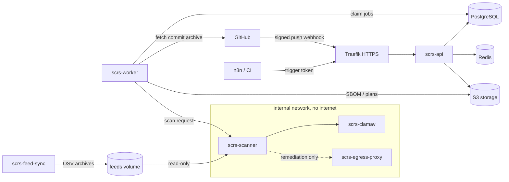

# SCRS: Software Supply Chain Risk Stack

SCRS is our in-house DevSecOps service for software supply-chain security. It
assesses every commit of our repositories and every pushed container image,
and documents each revision with two CycloneDX bills of materials:

- **SBOM (Software Bill of Materials):** what the software contains: every
  OS and language package, with versions and package URLs.
- **MBOM (Manufacturing Bill of Materials):** how the software is made: the
  build definitions and pinned inputs (CI workflows, Dockerfiles, build
  scripts, lockfiles) with SHA-256 digests, the produced commit or image
  digest, and the tools that verified it.

SCRS matches known vulnerabilities and malicious packages offline, scans file
content and image layers for malware and threat indicators, and keeps the
results in a single risk register with triage, waivers and an audit trail.
Automation such as n8n, CI pipelines and deploy tooling talks to it over one
authenticated REST API: inbound to trigger assessments, outbound through signed
webhooks.

SCRS started as a fork of [ajilach/clamav-rest](https://github.com/ajilach/clamav-rest),
a ClamAV scanner behind a REST API. That project is still the base: ClamAV is
the malware engine of the assessment pipeline, and the original REST scanner
remains in this repository as a hardened internal service. Everything else
(the API, the pipeline, the register, provider connections and the deployment)
was added on top. The full product specification is in
[Supply_Chain_Risk_Stack.md](Supply_Chain_Risk_Stack.md).

> **Status (2026-11-14):** repository (GitHub, GitLab) and container-image
> assessment with layer malware scanning, SBOM and MBOM, inbound automation
> triggers and signed outbound webhooks, relay and registry ingestion, Trivy
> and SARIF import, git-history mirrors, integrity alerts, YARA, KEV/EPSS, VEX
> export and scheduled maintenance are implemented and verified (see the
> [production-readiness audit](docs/PRODUCTION_READINESS_AUDIT.md)). Native
> Dependency-Track export, licences, built-in SAST and reachability remain on
> the [roadmap](#roadmap).

## Table of contents

- [What SCRS does today](#what-scrs-does-today)
- [What changed from the base project](#what-changed-from-the-base-project)
- [Architecture](#architecture)
- [Deploying on Dokploy (Traefik)](#deploying-on-dokploy-traefik)
- [First run: tokens, connections, first assessment](#first-run-tokens-connections-first-assessment)
- [Verdicts and CI gating](#verdicts-and-ci-gating)
- [Integrations: n8n, Trivy, Dependency-Track](#integrations-n8n-trivy-dependency-track)
- [API overview](#api-overview)
- [Security model](#security-model)
- [Roadmap](#roadmap)
- [Development and QA](#development-and-qa)
- [Documentation index](#documentation-index)
- [Base project: internal ClamAV REST scanner](#base-project-internal-clamav-rest-scanner)
- [History and credits](#history-and-credits)
- [License](#license)

## What SCRS does today

| Capability | What you get |
| --- | --- |
| **Provider connections** | GitHub (App, fine-grained PAT or OAuth token), GitLab (groups and subgroups, gitlab.com or self-managed), Docker Hub, Google Artifact Registry, Harbor and any OCI registry (GHCR, Quay, registry:2, Zot, Nexus). Credentials are stored AES-256-GCM encrypted and are never returned by the API. Include/exclude scope globs, credential rotation, disable without losing history. |
| **Asset discovery** | Inventories the repositories and images each connection can see and flags which are in scope. Only discovered, in-scope repositories can be assessed. |
| **Assessments** | One assessment per revision: a git commit (branch, tag-free push or pull-request head) or a container image digest. SCRS resolves refs and tags itself. A durable PostgreSQL job queue runs the pipeline with leases, retries, per-asset ordering and idempotency keys. Each assessment records a component diff and marks findings `new` or `existing` against the previous scan of the same ref, or the PR's base branch. |
| **Container images** | Images from any connected registry, resolved to a platform digest and streamed to the scanner (size-capped). OS and language packages, CycloneDX SBOM and offline OSV matching, plus ClamAV, YARA and IOC inspection of every layer file, including files a later layer deleted. Registry push events (Harbor, Docker Hub, GAR, CNCF Distribution) trigger assessments pinned to the pushed digest. |
| **SBOM** | CycloneDX 1.6 Software Bill of Materials per assessment, stored content-addressed in S3 and verified by hash on download (`/assessments/{id}/sbom`). |
| **MBOM** | CycloneDX 1.6 Manufacturing Bill of Materials per assessment (`/assessments/{id}/mbom`): the produced commit or image digest, the build definitions and pinned inputs observed in that revision with SHA-256 digests, verifying tools and stage results, linked to the SBOM. It records declared build inputs, not an observed CI run; pair it with SLSA provenance where you have it. |
| **Vulnerabilities** | Offline OSV-Scanner matching against a local OSV mirror refreshed every six hours (default ecosystems `npm,Go,Maven,PyPI,Pub,SwiftURL,RubyGems,Alpine,Debian`). Repository suppression files are ignored. CISA KEV and EPSS raise priority for known-exploited and likely-exploited advisories. |
| **Malicious packages** | OSV `MAL-` reports (OpenSSF malicious-packages data) matched during the same pass. |
| **Malware and YARA** | Every extracted file is streamed to ClamAV (`INSTREAM`). A starter YARA ruleset (miner pools, XMRig, base64-to-shell, secret exfiltration) is installed into ClamAV on each deploy; a canary proves it is loaded. Stale signatures reduce coverage and raise a posture finding. |
| **YARA rulesets (YARA-X)** | Team rules written in the Web UI and third-party packs (for example YARA Forge) run with YARA-X, including the `pe`, `elf`, `math`, `hash` and `dotnet` modules, on every repository file and image layer file. New rulesets hunt (record only); admins promote them to alert or block. See [docs/THREAT_INTELLIGENCE.md](docs/THREAT_INTELLIGENCE.md). |
| **Threat indicators (IOC)** | Indicator sources, each in hunt, alert or block mode with a minimum confidence: file SHA-256, SHA-1 and MD5, domains, IPv4, URLs, package URLs, file-path and file-content regexes, workflow step names, and PR-title, branch and commit-message patterns applied to incoming GitHub events (PRD Appendix E). |
| **Integrity** | Workflows that serialize all secrets, workflow files changed since the last revision, npm install hooks, fetch-and-execute build steps and hidden CI helper scripts. Provider events raise immediate alerts: force pushes, ref deletions, create-then-delete branch churn, mass deletions, default-branch, visibility and repository changes, new collaborators and organization members. |
| **External scanner import** | Trivy JSON (vulnerabilities, misconfigurations, secrets with values discarded) and SARIF 2.1.0 (Semgrep, CodeQL and similar) recorded as assessments, so their findings share the register, waivers and gate. |
| **Git history mirrors** | On-demand or scheduled git bundles of every branch and tag (GitHub and GitLab) in S3, fetched natively without a git binary, checksum-verified, pruned to the newest N, restorable with `git clone`. |
| **Risk register** | Findings deduplicated by fingerprint across assessments, with lifecycle `open → triaged → in_progress → fixed`. Time-boxed waivers (`accepted`), suppressions and false positives, with full event history. |
| **Guided remediation** | npm `package-lock.json` (in-place) and Maven `pom.xml` (override) plans generated in an isolated sandbox. Advice only: SCRS never writes to repositories. OpenVEX export reflects register triage. |
| **Automation API** | Token-scoped REST API (`admin`, `read`, `write`, `trigger`, `ingest:relay`). Inbound: idempotent and batch triggers carrying caller context, provider and registry webhooks. Outbound: signed event webhooks. Plus long-poll, latest-by-commit lookup, last-known-good revisions, Swagger UI and an OpenAPI contract. |
| **Outbound webhooks** | Signed (`X-SCRS-Signature`, plus `X-SCRS-Auth` for header-auth receivers such as n8n) events delivered from a transactional outbox with retries, dead-letter and redelivery: `assessment.completed`, `assessment.failed`, `finding.created`, `finding.status_changed`, `integrity.alert`, `feed.stale`, `connection.degraded`, `maintenance.completed`. `summary`, `full` and AI-`agent` payload profiles. |
| **Operations** | Owners and asset attributes, Prometheus metrics, request IDs and access logs, hourly maintenance (retention, key expiry, optional default-branch rescans), inbound-event log with replay, opt-in source snapshots for restore. |
| **Retention** | Policy-driven, previewable and audited purging of raw inbound events and the webhook delivery log. Findings, assessments and audit history are never purged. |

## What changed from the base project

| Area | Base project (clamav-rest) | This fork |
| --- | --- | --- |
| Purpose | Scan uploaded files for viruses | Assess whole repository revisions for supply-chain risk |
| Engines | ClamAV | ClamAV, OSV-Scanner (vulnerabilities and malicious packages), IOC matching, workflow-integrity checks |
| Results | Per-request HTTP response | Durable assessments, SBOMs, a deduplicated risk register and an audit log |
| Inputs | File uploads, host paths | GitHub commits via connections, signed webhooks or the trigger API |
| Auth | None (open CORS) | Hashed, scoped, expiring and revocable API tokens; Redis rate limits; exact CORS origins |
| Storage | None | PostgreSQL (state), Redis (admission control), S3-compatible storage (SBOMs and plans) |
| Deployment | Single container | Dokploy Compose stack behind Traefik with isolated scanner networking |
| ClamAV REST service | Public, unauthenticated, host-path scanning | Internal only, bearer token required, loopback ports, host-path routes return `410` |

## Architecture



All services run from one image (`deploy/Dockerfile.scrs`, a non-root `scratch`
image) except ClamAV, which uses the official image.

| Service | Role | Network exposure |
| --- | --- | --- |
| `scrs-storage-init` | Runs migrations and storage bootstrap, then exits | None |
| `scrs-api` | REST API on container port 7000 | Traefik only (`/scrs/v1/*`) |
| `scrs-worker` | Claims jobs, fetches snapshots, publishes results | Outbound to GitHub, PostgreSQL, S3 |
| `scrs-scanner` | Unpacks archives and runs OSV-Scanner, ClamAV and IOC checks | Internal `scanning` network only |
| `scrs-clamav` | ClamAV daemon; updates its own signatures | Internal plus outbound to ClamAV mirrors |
| `scrs-yara-rules` | One-shot: installs the embedded YARA ruleset into ClamAV's volume and reloads clamd | Internal |
| `scrs-feed-sync` | Downloads and validates OSV archives, CISA KEV and EPSS every 6 h | Outbound to the OSV bucket, cisa.gov and the EPSS host |
| `scrs-egress-proxy` | Allow-listed proxy for remediation (npm registry, deps.dev) | Internal |

PostgreSQL, Redis and S3 are external services you provide. The pipeline itself
is described in [docs/ASSESSMENT_PIPELINE.md](docs/ASSESSMENT_PIPELINE.md).

## Deploying on Dokploy (Traefik)

The full contract is in [docs/DOKPLOY.md](docs/DOKPLOY.md). In short:

1. Build and push the image, then record the concrete tag:

   ```bash
   make image-reference
   make release PLATFORMS=linux/amd64,linux/arm64
   ```

2. In Dokploy, create a Compose service from
   [`deploy/compose.dokploy.yaml`](deploy/compose.dokploy.yaml) and set every
   variable from [`.env.example`](.env.example). Generate secrets once:

   ```bash
   openssl rand -base64 32   # SCRS_MASTER_KEY: back it up outside the VPS
   openssl rand -hex 32      # SCRS_BOOTSTRAP_API_TOKEN
   openssl rand -hex 32      # SCRS_SCANNER_API_TOKEN (must differ)
   openssl rand -hex 32      # SCRS_GITHUB_WEBHOOK_SECRET (optional)
   ```

3. Set `SCRS_DOMAIN`, `SCRS_ROUTER_NAME`, `SCRS_TRAEFIK_NETWORK`, the entrypoints
   and `SCRS_CERT_RESOLVER` to match your Traefik. The Compose labels do the
   routing, so do not also add a domain in Dokploy's Domains UI.
4. Deploy. The first start can take several minutes while the OSV feeds
   download (npm alone is about 220 MiB). The worker starts once the scanner
   reports healthy.
5. Set `SCRS_PUBLIC_BASE_URL` and run `make deployment-acceptance`.

Without a published host port the API is reachable only through Traefik. For
diagnostics on the VPS itself, add
[`deploy/compose.nodeport.yaml`](deploy/compose.nodeport.yaml) to bind
`127.0.0.1:${SCRS_HTTP_NODE_PORT:-7000}`.

Losing `SCRS_MASTER_KEY` makes every stored provider credential unreadable.
A database backup cannot recover it.

## First run: tokens, connections, first assessment

Examples use `BASE=https://your-domain/scrs/v1` and the bootstrap admin token.
Swagger UI at `$BASE/docs` documents every request and response.

```bash
# 1. Create narrower tokens. The secret is returned once.
curl -sX POST "$BASE/tokens" -H "Authorization: Bearer $ADMIN" -H 'Content-Type: application/json' \
  -d '{"name":"n8n-trigger","scopes":["trigger"]}'
curl -sX POST "$BASE/tokens" -H "Authorization: Bearer $ADMIN" -H 'Content-Type: application/json' \
  -d '{"name":"dashboards","scopes":["read"]}'

# 2. Connect a GitHub organization, then test it and discover repositories.
curl -sX POST "$BASE/connections" -H "Authorization: Bearer $ADMIN" -H 'Content-Type: application/json' -d '{
  "provider":"github","name":"github-main",
  "config":{"organization":"YourOrg","auth_type":"fine_grained_pat"},
  "scope":{"include":["YourOrg/*"]},
  "credential":{"token":"github_pat_..."}}'
curl -sX POST "$BASE/connections/$CONNECTION_ID:test" -H "Authorization: Bearer $ADMIN"
curl -sX POST "$BASE/connections/$CONNECTION_ID:discover" -H "Authorization: Bearer $ADMIN"

# 3. Trigger an assessment (202 Accepted plus a Location header).
curl -si -X POST "$BASE/assessments" -H "Authorization: Bearer $TRIGGER" \
  -H 'Content-Type: application/json' -H 'Idempotency-Key: demo-1' \
  -d '{"target":{"type":"git","repository":"YourOrg/api","ref":"main"}}'

# 4. Read the results.
curl -s "$BASE/assessments/$ID" -H "Authorization: Bearer $TRIGGER"                  # status, verdict, counts
curl -s "$BASE/assessments/$ID/findings" -H "Authorization: Bearer $TRIGGER"
curl -s "$BASE/assessments/$ID/sbom" -H "Authorization: Bearer $TRIGGER" -o sbom.cdx.json
curl -s "$BASE/assessments/$ID/report?format=md" -H "Authorization: Bearer $TRIGGER"  # PR-comment sized
```

GitHub App connections and Docker Hub/GAR examples are in
[docs/PROVIDERS.md](docs/PROVIDERS.md).

## Verdicts and CI gating

Each assessment ends with a verdict. They rank `fail` > `incomplete` > `warn` > `pass`:

| Verdict | Meaning |
| --- | --- |
| `fail` | Malware, a malicious dependency or an IOC match (new or existing); a **new** critical vulnerability; a **new** high or critical integrity entry. Reported even when coverage was partial. |
| `incomplete` | No blocking finding, but at least one stage was skipped, partial or hit a limit. **Never treat this as `pass`.** |
| `warn` | A new high vulnerability, an existing critical one, a new medium or existing serious integrity entry, or waived malicious content (which can never drop below `warn`). |
| `pass` | Every stage completed and nothing gates. |

"New" means absent from the previous successful scan of the same ref (or of
the base branch for a pull request). Unexpired waivers (`accepted`),
suppressions and false positives do not gate, and are counted under
`counts.waived`. Absence from a later scan of the same branch head closes a
finding as `fixed` when the stages that produce it completed; change records
(workflow changes, provider events) stay open until reviewed.

A repository can reach `pass` once ClamAV signatures are fresh, the YARA
ruleset is loaded and an indicator bundle is imported (`PUT /feeds/indicators`).
**Block deploys on `verdict == "fail"`** and show `incomplete` as "no known
blocker, partial coverage".

## Integrations: n8n, Trivy, Dependency-Track

SCRS is designed to sit next to the tools we already run, not to replace them
on day one (PRD section 15.1).

### n8n

| Flow | Status |
| --- | --- |
| **Inbound trigger (automation webhook):** an n8n HTTP Request node posts the event to `POST /scrs/v1/assessments` with a `trigger` token restricted to n8n's IP: `target` names a discovered, in-scope asset, and `trigger.context` carries correlation data (ticket, change request, execution id) that comes back in `assessment.completed`. Use the source event id as `Idempotency-Key` so retries never double-scan. | Available |
| **Polling for results:** the response carries `Location` and `Retry-After`. Poll `GET /assessments/{id}` until `status` is `succeeded` or `failed`, then branch on `verdict` (Slack/Telegram message, ticket, or a GitHub commit status written with n8n's own credential). | Available |
| **Direct GitHub webhook** (no n8n in the path): point an organization webhook at `/scrs/v1/webhooks/github` with `SCRS_GITHUB_WEBHOOK_SECRET`. | Available |
| **Relay mode:** n8n forwards GitHub's or GitLab's unchanged body to `/scrs/v1/ingest/github` or `/ingest/gitlab` with an `ingest:relay` token (`SCRS_RELAY_ENABLED=true`); a forwarded provider signature is verified too when SCRS holds the provider secret. | Available |
| **Registry push events:** Harbor calls `/ingest/registry/harbor` directly; Docker Hub and GAR Pub/Sub go through the registry relay workflow. | Available |
| **Outbound webhooks:** signed `assessment.completed`, `finding.created`, `integrity.alert` and more, with retries, dead-letter, redelivery and an AI-triage `agent` profile. | Available |
| **Batch trigger and nightly reconcile** (`/assessments:batch`, `/maintenance/rescan`) | Available |
| **Reference workflows** ([docs/integrations](docs/integrations/N8N.md)): GitHub relay, GitLab relay, registry relay, completion to commit status (Header Auth, no Code node), nightly reconcile; import-tested on n8n 1.97.1 | Available |

SCRS never writes back to GitHub. Commit statuses and PR comments come from n8n.

**Inbound and outbound together.** A typical n8n loop:

1. n8n receives an external event (release request, ticket, schedule) and calls
   SCRS inbound:

   ```bash
   curl -X POST "$BASE/assessments" -H "Authorization: Bearer $N8N_TRIGGER_TOKEN" \
     -H "Idempotency-Key: exec-4711" -H 'Content-Type: application/json' \
     -d '{"target":{"type":"git","repository":"acme/api","ref":"main"},
          "trigger":{"origin":"n8n","event":"release.requested","delivery_id":"exec-4711",
                     "actor":"release-bot","context":{"ticket":"CHG-1042","environment":"prod"}}}'
   ```

2. SCRS answers `202` with the assessment id. The token's scope, IP allow-list
   and rate limit are enforced, and only discovered, in-scope assets on enabled
   connections are accepted (`404` otherwise).
3. When the scan finishes, SCRS calls n8n outbound with `assessment.completed`
   (signed, with `X-SCRS-Auth`). `data.assessment.trigger.context` carries
   `CHG-1042` back, so the workflow updates the right ticket.

Context is correlation data only: at most 20 keys matching
`^[a-z0-9][a-z0-9._-]{0,62}$`, values up to 256 printable characters, never used
to choose what is scanned. Provider events take the dedicated inbound
endpoints (`/ingest/github`, `/ingest/gitlab`, `/ingest/registry/*`), which
verify each provider's signature or token.

### Trivy

Run Trivy in CI and post its JSON report to `POST /scrs/v1/assessments:import`
(`"format":"trivy"`, with the scanned commit or image digest as
`target.commit`). Its vulnerabilities, misconfigurations and secrets join the
same register, triage and waivers; secret values are discarded before storage.
SARIF from Semgrep, CodeQL or other SAST tools imports the same way
(`"format":"sarif"`). SCRS now covers image layers itself (packages, ClamAV,
YARA, IOCs), so Trivy remains useful mainly for misconfiguration and secret
rules.

### OWASP Dependency-Track

Keep Dependency-Track for portfolio-level component tracking. Every SCRS
assessment already produces a CycloneDX SBOM (`GET /assessments/{id}/sbom`) and
MBOM (`GET /assessments/{id}/mbom`),
so an n8n workflow can forward it to Dependency-Track's BOM upload API today.
Check the upload endpoint and API-key permissions for your Dependency-Track
version. A native SBOM export from SCRS is a planned P2 feature.

## API overview

All routes live under `/scrs/v1`. An `admin` token satisfies every scope.
`trigger` tokens see only the assessments they created.

**Backoffice integration.** Swagger UI (`/scrs/v1/docs`) documents all 74
operations by tag, with request and response schemas, scopes and error codes.
Generate a typed client from `/scrs/v1/docs/openapi.yaml` (for example
`npx openapi-typescript https://scrs.example.com/scrs/v1/docs/openapi.yaml -o scrs.d.ts`).
Call SCRS from the backoffice backend with a server-side token, not from the
browser: tokens are long-lived bearer secrets. If the browser must call SCRS
directly, list the exact backoffice origin in `SCRS_CORS_ORIGINS`, use a
`read` token, and restrict it with `ip_allow_list`. Lists paginate with
`next_cursor`; mutable resources use `ETag`/`If-Match`; errors are
`{"error": "..."}`. `api/contract_test.go` and `internal/httpapi/contract_test.go`
fail the build if a route is added without documentation.

| Route | Scope | Purpose |
| --- | --- | --- |
| `GET /system/healthz`, `GET /system/readyz` | Public | Liveness; readiness of PostgreSQL, Redis and S3 |
| `GET /docs`, `GET /docs/openapi.yaml` | Public (configurable) | Swagger UI and contract |
| `/tokens`, `DELETE /tokens/{id}` | admin | Create, list and revoke API tokens |
| `/connections`, `/connections/{id}`, `:test`, `:discover`, `:rotate-credential` | admin | Provider accounts, scope and credentials |
| `GET /assets` | read | Discovered assets and scope flags |
| `GET/POST /assets/{id}/mirrors`, `GET /assets/{id}/mirrors/{mirror}/bundle` | read, write / admin | Git history mirrors and bundle download |
| `POST /assessments:import` | write, trigger | Trivy JSON or SARIF import |
| `POST /assessments` | write, trigger | Queue an assessment |
| `POST /assessments:batch` | write, trigger | Up to 100 targets with per-item results |
| `GET /assessments`, `/assessments/latest`, `/assessments/{id}` and `/findings`, `/components`, `/files`, `/sbom`, `/mbom`, `/report`, `/context`, `/vex`, `/remediations`, `/remediation` | read, write, trigger | Results, SBOM and MBOM, context documents and OpenVEX |
| `GET /assessments/{id}/snapshot` | admin | Stored source archive |
| `GET/PATCH /assets/{id}`, `GET /assets/{id}/last-known-good`, `GET/POST /owners`, `PATCH /owners/{id}` | read / write | Ownership and asset attributes |
| `/webhooks`, `/webhooks/{id}`, `:test`, `:rotate-secret`, `/deliveries`, `:redeliver` | admin | Outbound webhook subscriptions and delivery log |
| `POST /ingest/github`, `POST /ingest/gitlab` | Provider secret or `ingest:relay` | Direct or relayed GitHub and GitLab events |
| `POST /ingest/registry/{harbor,dockerhub,gar,oci}` | ingest:relay | Registry push events |
| `/maintenance/run`, `/maintenance/rescan`, `/maintenance/redeliver-dead`, `/events/inbound`, `:replay` | admin | Maintenance and inbound-event log |
| `GET /system/metrics` | read | Prometheus metrics |
| `GET /system/github-webhooks`, `POST /system/github-webhooks:check` | read, admin | GitHub webhook delivery check: redelivers missed events, reports hook misconfiguration |
| `DELETE /assessments/{id}` | write (or owning trigger) | Cancel |
| `GET /register`, `GET /register/{id}/events` | read, write | Risk register and finding history |
| `PATCH /register/{id}` | write; admin to accept, suppress or mark false positive | Triage |
| `POST /assets/{id}/remediations`, `GET /remediation/capabilities` | write / read | Guided remediation plans |
| `GET`/`PUT /feeds/indicators` | admin | IOC bundle (the `bundle` source) |
| `/intel/indicator-sources` (list, create, get, patch, delete, `/indicators` get and put, `:hunt`) | read, write (hunt), admin (alert, block) | Indicator sources |
| `/intel/yara-rulesets` (list, create, `:validate`, get, patch, delete, `:hunt`) | read, write (hunt), admin (alert, block) | YARA rulesets |
| `/settings/retention`, `:preview`, `:purge` | admin | Raw-event retention |
| `POST /webhooks/github` | GitHub HMAC | Signed push events |

## Security model

- **Tokens:** only SHA-256 hashes are stored. Tokens are scoped, can expire,
  can be restricted to IP ranges and are revocable. Revocation is checked in
  PostgreSQL on every request. Redis limits each token to 120 requests per
  minute and fails closed.
- **Credentials:** provider secrets are AES-256-GCM encrypted under
  `SCRS_MASTER_KEY`. Scanner subprocesses inherit no credentials.
- **Untrusted code:** archives are unpacked with traversal, link, special-file
  and size limits. Nothing in a repository is built or executed. The scanner
  network has no internet access. Remediation egress is allow-listed to public
  npm and deps.dev addresses.
- **Data safety:** there is no hard-delete API. Deleting a connection disables
  it and keeps its history. Retention only touches raw inbound events.
  Findings, assessments and the audit log are kept.
- **Edge:** Traefik terminates TLS. Forwarded client IPs are trusted only from
  `SCRS_TRUSTED_PROXY_CIDRS`. CORS accepts exact origins only.

## Roadmap

Milestones follow PRD section 15.2.

| Milestone | Status |
| --- | --- |
| M1 Platform core | Done: tokens, audit, owners and asset attributes, metrics, request IDs, access logs |
| M2 Repository scanning | Done: trigger, batch, latest, long-poll, direct and relay GitHub ingestion, PR assessments, diffs and new-versus-existing gating, integrity events |
| M3 Malware and malicious dependencies | Done: ClamAV, YARA via ClamAV with canary, `MAL-` matching, campaign IOC types, KEV and EPSS |
| M4 Threat-intelligence feeds | Done: indicator bundles, KEV/EPSS, Trivy and SARIF import, YARA-X rulesets (team and third-party), indicator sources with modes and confidence. STIX 2.1 and TAXII 2.1 in progress; CSV, VEX import and NVD outstanding |
| M5 Retention, maintenance, outbound | Done: signed outbound webhooks with profiles and header auth, scheduler, maintenance actions, event log and replay, n8n workflows, source snapshots, git-bundle mirrors |
| M6 Images and registries | Done: Docker Hub, GAR, Harbor and OCI images by digest with layer malware/YARA/IOC scanning; registry push events; GitLab repositories and webhooks |
| M7 Remediation and hardening | Done: npm and Maven plans, OpenVEX export, load and crash-recovery test |
| M8 Licences, SPDX, compliance reports | Not started |
| M9 SAST and reachability | SARIF import of external SAST done; built-in SAST and reachability not started |
| Dependency-Track SBOM export (P2) | Not started (forward SBOMs through n8n until then) |

## Development and QA

Requires Go (see `go.mod`), Docker and Python 3.

```bash
make build                 # bin/scrs
make test lint             # race tests, gofmt, go vet
make qa                    # test + lint + contract checks + deployment-config tests
make database-test         # disposable PostgreSQL/Redis/MinIO integration
make scanner-test          # real OSV-Scanner against adversarial fixtures
make malware-test          # private ClamAV: clean file and EICAR
make storage-integration   # production image against disposable stores
```

To run locally, copy `.env.example` to `.env`, fill in the placeholders, then
`make storage-init` and `python3 scripts/run_with_env.py bin/scrs api`. Open
`http://localhost:7000/scrs/v1/docs`.

## Documentation index

| Document | Contents |
| --- | --- |
| [Supply_Chain_Risk_Stack.md](Supply_Chain_Risk_Stack.md) | Product requirements and architecture (the PRD) |
| [docs/DOKPLOY.md](docs/DOKPLOY.md) | Deployment contract, tokens, backup and recovery |
| [docs/ASSESSMENT_PIPELINE.md](docs/ASSESSMENT_PIPELINE.md) | Pipeline design, limits and finding lifecycle |
| [docs/PROVIDERS.md](docs/PROVIDERS.md) | GitHub, Docker Hub and GAR connections |
| [docs/FOUNDATION.md](docs/FOUNDATION.md) | URL contract and local work |
| [docs/RELEASING.md](docs/RELEASING.md) | Image tags and releases |
| [docs/PRODUCTION_READINESS_AUDIT.md](docs/PRODUCTION_READINESS_AUDIT.md) | Latest engineering audit and open risks |
| [docs/PRD_EXPANSION_AUDIT.md](docs/PRD_EXPANSION_AUDIT.md), [docs/PRD_PROGRESS_AND_AUDIT.md](docs/PRD_PROGRESS_AND_AUDIT.md), [docs/AUDIT_2026-11-12.md](docs/AUDIT_2026-11-12.md) | Earlier audits and evidence |

## Base project: internal ClamAV REST scanner

The original clamav-rest service (`clamrest.go`, the root `Dockerfile` and
`docker-compose*.yml`) is still here for internal callers that need ad-hoc file
scanning. It is **not** part of the SCRS API or the Dokploy stack; the SCRS
pipeline talks to its own `scrs-clamav` daemon directly. This fork hardened the
base service:

- every route except `/` and `/version` requires
  `Authorization: Bearer $SCRS_SCANNER_API_TOKEN` (at least 32 characters),
- `/scanFile` and `/scanPath` (host-path scanning) return `410 Gone`; upload content instead,
- concurrency is limited to four scans (`429` with `Retry-After` beyond that) and bodies to 100 MiB,
- the Compose files bind ports 9000/9443 to `127.0.0.1` only.

```bash
export SCRS_SCANNER_API_TOKEN=$(openssl rand -hex 32)
docker compose up -d --build
curl -i -H "Authorization: Bearer $SCRS_SCANNER_API_TOKEN" -F "file=@eicar.com.txt" http://127.0.0.1:9000/v2/scan
# 406 Not Acceptable: [{"Status":"FOUND","Description":"Eicar-Test-Signature","FileName":"eicar.com.txt"}]
```

| Endpoint | Description |
| --- | --- |
| `POST /v2/scan` | Multipart upload of one or more files; returns a JSON array with status, description and file name |
| `POST /scanHandlerBody` | Scans the raw request body |
| `POST /scan` | Deprecated predecessor of `/v2/scan` |
| `GET /version` | ClamAV engine, signature version and signature date (unauthenticated) |
| `GET /metrics` | Prometheus metrics |
| `GET /` | Process stats (unauthenticated) |

Status codes: `200` clean, `406` infected, `400` ClamAV error, `401` missing or
invalid token, `410` retired host-path route, `412` unparsable input, `413` file
over `MAX_FILE_SIZE`, `422` missing file name, `429` capacity reached.

ClamAV tuning variables from the base project still apply: `MAX_SCAN_SIZE`
(100M), `MAX_FILE_SIZE` (25M), `MAX_RECURSION` (16), `MAX_FILES` (10000),
`SIGNATURE_CHECKS` (2 per day), the `PROXY_*` settings for freshclam, and the
other `MAX_*`/`PCRE_*` limits. To enable HTTPS on 9443, mount a certificate at
`/etc/ssl/clamav-rest/server.crt` and its key at `server.key`. The
[upstream README](https://github.com/ajilach/clamav-rest#readme) covers airgapped signature updates, custom `freshclam.conf` and signature-age
monitoring in detail. `kubernetes_example/` and `centos.Dockerfile` are
inherited unchanged and are not supported deployments of this fork.

## History and credits

SCRS is built on [ajilach/clamav-rest](https://github.com/ajilach/clamav-rest),
which descends from [o20ne/clamav-rest](https://github.com/o20ne/clamav-rest),
[niilo/clamav-rest](https://github.com/niilo/clamav-rest) and the original
[osterzel/clamav-rest](https://github.com/osterzel/clamav-rest). Scanning relies
on [ClamAV](https://www.clamav.net), [OSV-Scanner](https://github.com/google/osv-scanner)
and the [OSV](https://osv.dev) and [OpenSSF malicious-packages](https://github.com/ossf/malicious-packages)
data. Third-party components and licences are listed in Appendix A of the PRD.

## License

MIT, as inherited from the base project. See [LICENSE.md](LICENSE.md).
