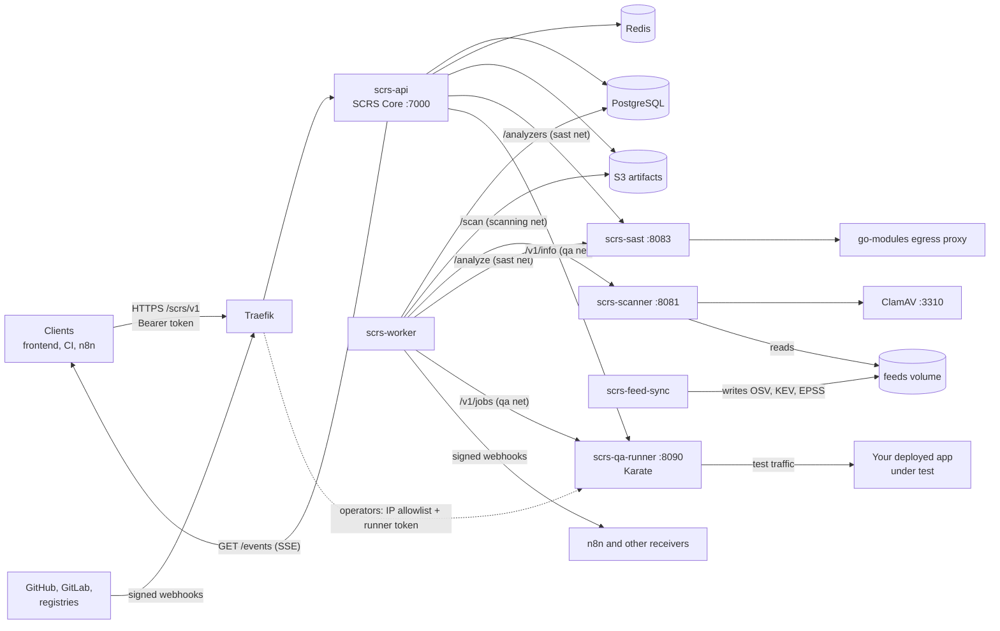

# The SCRS stack: how the parts connect

SCRS is one public REST service, **SCRS Core** (`scrs-api`), with a set of private services behind it. Every client, whether a frontend, CI, n8n or a provider webhook, talks to Core only (QA operators may also use the runner directly, see below). Core owns authentication, scopes, rate limits and the contract; the scanner, SAST service and QA runner are internal workers that Core and the worker call with their own tokens.

- Contract and Swagger UI: `GET /scrs/v1/docs` (served by Core, unless `SCRS_SWAGGER_DOCS_ENABLE=false`).
- Every endpoint with its scope, grouped by module: [API_REFERENCE.md](API_REFERENCE.md) (generated from the contract).
- Verifying a deployment: [STAGING_ACCEPTANCE.md](STAGING_ACCEPTANCE.md) (acceptance scripts, restart, backup and load checks).
- Building a UI: [FRONTEND_GUIDE.md](FRONTEND_GUIDE.md) (call order, roles, live events, pagination and concurrency).
- Deployment: [DOKPLOY.md](DOKPLOY.md). Decisions: [ADR.md](ADR.md).

## Topology



Networks (all `internal: true` except `proxy`): `scanning` (worker, scanner, ClamAV, YARA installer, egress proxy), `sast` (API, worker, SAST, its egress proxy), `qa` (API, worker, runner), and `proxy` (Traefik). A service that is not on a network cannot reach it, so the scanner has no route to the internet and SAST can only fetch Go modules.

## The components

| Service | Role | Port | Who calls it | Authentication | Health |
| --- | --- | --- | --- | --- | --- |
| `scrs-api` (**Core**) | The only public API. Validates, authorizes and queues work; serves results, the contract, `/events` and `/system/status` | 7000 | Clients through Traefik | Bearer tokens with scopes | `/system/healthz`, `/system/readyz` (public), `/system/status` (token) |
| `scrs-worker` | Runs the queue: fetches sources and images, builds the SBOM, orchestrates scanner, SAST and runner, writes findings, delivers webhooks | none | Postgres queue (leases) | Holds the service tokens below | Heartbeat shown in `/system/status` |
| `scrs-scanner` | Offline OSV matching, KEV and EPSS enrichment, malware and IOC scanning | 8081 | Worker | `SCRS_SCANNER_API_TOKEN` | `/healthz` (feeds loaded and fresh) |
| `scrs-clamav`, `scrs-yara-rules` | Malware engine and the starter YARA ruleset | 3310 | Scanner | Network isolation | Compose healthcheck |
| `scrs-feed-sync` | Downloads OSV and enrichment feeds into the shared volume | none | none | none | Stale sources show in `/system/status` |
| `scrs-sast` | Bundled analyzers (gosec, Bandit, OpenGrep, Bearer) and Go reachability, run without network | 8083 | Worker, and Core for `/sast/analyzers` | `SCRS_SAST_API_TOKEN` | `/healthz` (503 if an enabled analyzer is missing) |
| `scrs-qa-runner` | Runs Karate API, UI and load jobs against your deployed environment | 8090 | Worker, and Core for `/qa/runner` | `SCRS_QA_RUNNER_TOKEN` | `/healthz` (503 names a broken prerequisite) |
| `scrs-embed` | Self-hosted text embeddings (CPU) for the chronicle's search | 80 | Worker only (`embed` network) | `SCRS_EMBED_API_KEY` | `/health` |
| `scrs-model` (second machine, optional) | Self-hosted code model (llama.cpp) for AI code review and unit tests, for data that must stay on your hardware; a hosted provider is the alternative | 8080 behind Traefik | Worker, over HTTPS | `SCRS_MODEL_API_KEY`, IP allowlist | `/health` (see [MODEL_HOST.md](MODEL_HOST.md)) |
| `scrs-storage-init` | One-shot migrations and storage checks | none | Compose at start | Admin DB URL, first start only | exits 0 |

Core and the worker are the same image (`scrs`); the worker is the `worker` command. Traefik also publishes the runner at `SCRS_QA_DOMAIN`, behind an IP allowlist (`SCRS_QA_RUNNER_ALLOWED_CIDRS`, default nobody) and its token. That route is for operators: it lets them trigger standalone QA, performance and load jobs (`POST /v1/jobs`) that have nothing to do with supply-chain risk. Core and the worker reach the runner over the internal `qa` network and do not use the public route.

The runner has two entry paths, and only the first touches SCRS data:

| Path | Who | What happens |
| --- | --- | --- |
| Through Core | Worker, after a successful assessment that did not `fail` (or `POST /assets/{id}/qa/runs`) | Run, scenarios, coverage and `qa_*` findings stored; `qa.completed` and `qa.failed` events; report archived in S3 |
| Direct | An operator or CI tool with the runner token and an allow-listed address | Functional (Karate API, UI) or performance (Gatling) job on the runner; the report is fetched from the runner. Nothing is recorded in SCRS, and the runner shares its slots with the first path |

The runner never handles SBOMs, MBOMs, vulnerabilities, malware or integrity data. It has no lint job kind; a lint workflow would need a new kind or a Karate feature that drives a linter you provide.

## Which settings join which parts

| Link | Set on the caller | Set on the callee |
| --- | --- | --- |
| Worker to scanner | `SCRS_SCANNER_URL`, `SCRS_SCANNER_API_TOKEN` | `SCRS_SCANNER_API_TOKEN` |
| Core and worker to SAST | `SCRS_SAST_URL`, `SCRS_SAST_API_TOKEN`; enable with `SCRS_SAST_ENABLED`, `SCRS_REACHABILITY_ENABLED` | `SCRS_SAST_API_TOKEN` (32+ characters) |
| Core and worker to the QA runner | `SCRS_QA_RUNNER_URL`, `SCRS_QA_RUNNER_TOKEN` | `SCRS_QA_RUNNER_TOKEN` (32+ characters) |
| Clients to Core | `SCRS_PUBLIC_BASE_URL` (event links), `SCRS_CORS_ORIGINS` (browser origins) | `SCRS_BOOTSTRAP_API_TOKEN` creates the first admin token |
| Webhooks in | per-connection secrets (`POST /connections/{id}:webhook`) | `SCRS_RELAY_ENABLED` for relayed events |

Each token is a separate secret. A leaked scanner token does not open SAST or the runner, and none of them is an API token.

## How the pieces work together

**1. An assessment (the main path).** A client with `trigger` or `write` calls `POST /assessments` (send an `Idempotency-Key`). Core checks the asset is discovered and in scope, stores the job in PostgreSQL, and answers `202`. The worker leases the job, fetches the source or image through the connection, builds the inventory, and calls the scanner for vulnerabilities, malware and IOCs. If SAST or reachability is enabled for the asset, it sends the source archive to `scrs-sast`. Findings go to the register in PostgreSQL, artifacts (SBOM, MBOM, reports) to S3, and the verdict is `fail`, `incomplete`, `warn` or `pass`. Clients read results through `GET /assessments/{id}` and its `/findings`, `/components`, `/sbom`, `/mbom`, `/vex`, `/report` and `/context` sub-resources.

**2. QA runs.** An asset with a QA profile gets a run after a successful assessment that did not `fail`. The worker packs the suites, submits them to the runner (`/v1/jobs`), polls, and stores the report in S3. Results come back through `/qa/runs/{id}` and the assessment's `/qa`, and failing scenarios become report-only `qa_*` findings. A run on the runner needs `SCRS_QA_MAX_ACTIVE` capacity; generation of tests by an LLM goes through `/llm/providers` and `/assets/{id}/qa/generations`.

**3. Events.** Everything that changes state writes an event in the same database transaction. The worker's dispatcher delivers it as a signed webhook (retries, dead letters, redelivery), and PostgreSQL announces it so every Core instance can push it to open `GET /events` streams. Platform health is announced as `system.degraded` and `system.recovered`.

**4. Inbound events.** GitHub, GitLab and registry webhooks reach Core's `/ingest/*` routes. They authenticate with a signature or a connection secret, or arrive from a relay with an `ingest:relay` token. Core queues assessments exactly as in flow 1.

**5. Reading status.** `GET /system/status` aggregates PostgreSQL, Redis, S3, the worker heartbeat, the scanner and feeds, SAST (through `/analyzers`) and the runner (through `/v1/info`). The frontend never calls a private service directly.

## Which scope a client needs

| Client | Scope | Calls |
| --- | --- | --- |
| Dashboard or frontend | `read` | Register, assessments, SBOMs, reports, QA results, `/system/status`, `/events` |
| CI pipeline or engineer | `write` | The above, plus `POST /assessments`, triage in `/register/{id}`, QA runs, report requests |
| Automation that only starts scans (n8n) | `trigger` | `POST /assessments`, `POST /assets/{id}/qa/runs`, read its own assessments |
| Webhook relay | `ingest:relay` | `/ingest/*` (needs `SCRS_RELAY_ENABLED=true`) |
| Platform owner | `admin` | Tokens, connections, subscriptions, retention, maintenance, audit, waivers, runner and SAST secrets, enforcing modes |

The exact scope of every operation is in [API_REFERENCE.md](API_REFERENCE.md) and in each operation's `security` in the contract.

## Modules and where to find them

| Module | Contract tag | Main endpoints | Guide |
| --- | --- | --- | --- |
| Platform, health, metrics | System | `/system/healthz`, `/readyz`, `/status`, `/metrics` | [DOKPLOY.md](DOKPLOY.md) |
| Auth | Tokens | `/tokens` | contract introduction |
| Provider connections and discovery | Connections | `/connections`, `:test`, `:discover`, `:webhook` | [PROVIDERS.md](PROVIDERS.md) |
| Assets, owners, history | Assets, Mirrors | `/assets`, `/owners`, `/assets/{id}/mirrors` | [PROVIDERS.md](PROVIDERS.md) |
| Assessments and results (SCA, malware, SBOM, MBOM, VEX) | Assessments, Assessment results | `/assessments`, `/assessments/{id}/...` | [ASSESSMENT_PIPELINE.md](ASSESSMENT_PIPELINE.md) |
| External findings import | Imports | `/assessments:import` | [ASSESSMENT_PIPELINE.md](ASSESSMENT_PIPELINE.md) |
| Risk register and remediation | Risk register, Remediation | `/register`, `/register/{id}`, `/register/summary`, `/register/export`, `/assets/{id}/remediations` | [ASSESSMENT_PIPELINE.md](ASSESSMENT_PIPELINE.md) |
| Inbound webhooks and registries | Ingest | `/ingest/...`, `/webhooks/github` | [PROVIDERS.md](PROVIDERS.md) |
| Outbound webhooks | Webhook subscriptions | `/webhooks`, deliveries, `:test` | [integrations/N8N.md](integrations/N8N.md) |
| Threat intelligence and vulnerability sources | Threat intelligence | `/intel/...` | [THREAT_INTELLIGENCE.md](THREAT_INTELLIGENCE.md) |
| Retention and maintenance | Operations | `/settings/retention`, `/maintenance/...`, `/audit` | [DOKPLOY.md](DOKPLOY.md) |
| SAST and reachability | SAST | `/sast/...`, `/assets/{id}/sast`, `/reachability/capabilities` | [SAST.md](SAST.md) |
| E2E QA (Karate) | E2E QA, LLM providers | `/assets/{id}/qa/...`, `/qa/...`, `/llm/...` | [QA_TESTING.md](QA_TESTING.md) |
| AI code review (self-hosted model) | AI review, LLM providers | `/assets/{id}/ai-reviews`, `/ai-reviews/{id}` | [LLM_KNOWLEDGE.md](LLM_KNOWLEDGE.md), [MODEL_HOST.md](MODEL_HOST.md) |
| AI advisories, summaries and the chronicle | Advisories and summaries | `/assessments/{id}/summaries`, `/summary-jobs/{id}`, `/assets/{id}/chronicle` | [LLM_KNOWLEDGE.md](LLM_KNOWLEDGE.md) |
| Licences | Licences | `/policies/license`, `/licenses/...`, `/assets/{id}/licenses` | [LICENSES_AND_COMPLIANCE.md](LICENSES_AND_COMPLIANCE.md) |
| Compliance reports, STIG, PDF | Compliance reports | `/reports/...`, `/frameworks/{id}` | [LICENSES_AND_COMPLIANCE.md](LICENSES_AND_COMPLIANCE.md) |
| Dependency-Track link (SBOM upload, findings read-back, shared triage) | Integrations | `/integrations/dependency-track/...` | [README.md](../README.md#owasp-dependency-track), [ADR.md](ADR.md) (ADR-033) |
| Live events | Live events | `GET /events`, `/schemas/events` | contract, `/events` |

## Failure behaviour: what a client sees when a part is down

| Part down | Effect | Where it shows |
| --- | --- | --- |
| PostgreSQL, Redis or S3 | Core answers `503` on `/system/readyz`; token checks fail closed | `/system/status` overall `down`; no event can be recorded for a PostgreSQL outage |
| Worker | Assessments stay queued; nothing is lost | `worker` is `down` after 15 minutes without a heartbeat |
| Scanner or stale feeds | Scans are rejected or finish `incomplete`, never `pass` | `scanner` or `feeds` not `ok`; `feed.stale` event |
| ClamAV or stale signatures | Malware coverage is partial, so the verdict is `incomplete` | Posture finding in the register |
| SAST | A failed analyzer makes the assessment `incomplete`, never `pass` (SAST-011); the SAST gate itself is report-only | `sast` is `down` or `degraded` |
| QA runner | A run fails after repeated submission attempts; assessments are unaffected | `qa_runner` is `down`; `qa.failed` event |
| Dependency-Track (optional export) | Assessments are unaffected; uploads queue and retry for about two days | `dependency_track` is `down` (unreachable) or `degraded` (failed uploads, imports or syncs; old backlog); `dependency_track.upload_failed` event. DT-only findings stop updating |
| Traefik or DNS | Clients cannot reach Core; the runner's callbacks fail | Outside the stack: probe `/system/healthz` from where the client runs |

An `incomplete` verdict is not a clean result: gate on `fail` and never treat `incomplete` as `pass`.

## Integrating a frontend: the first calls

```bash
BASE=https://your-domain/scrs/v1
# 1. Is the platform up? (no token)
curl -s $BASE/system/readyz
# 2. Component detail for a status page (read)
curl -s -H "Authorization: Bearer $READ_TOKEN" $BASE/system/status
# 3. Start an assessment (write or trigger); retries with the same key never double-scan
curl -s -X POST $BASE/assessments -H "Authorization: Bearer $WRITE_TOKEN" \
  -H "Idempotency-Key: $(uuidgen)" -H 'Content-Type: application/json' \
  -d '{"target":{"type":"git","repository":"org/app","ref":"main"}}'
# 4. Follow it: poll GET /assessments/{id}, or stream events (read)
curl -N -H "Authorization: Bearer $READ_TOKEN" "$BASE/events?types=assessment.completed,system.degraded"
```

Browsers cannot send an `Authorization` header with `EventSource`; use `fetch` streaming. Keep tokens out of URLs and out of the frontend bundle: call SCRS from your own backend, which holds the token. If the browser must call SCRS directly, set `SCRS_CORS_ORIGINS` to the exact browser origins and use a narrowly scoped `read` token.

Reload state when a stream connects or reconnects, and on its `resync` event; missed events are not replayed.
